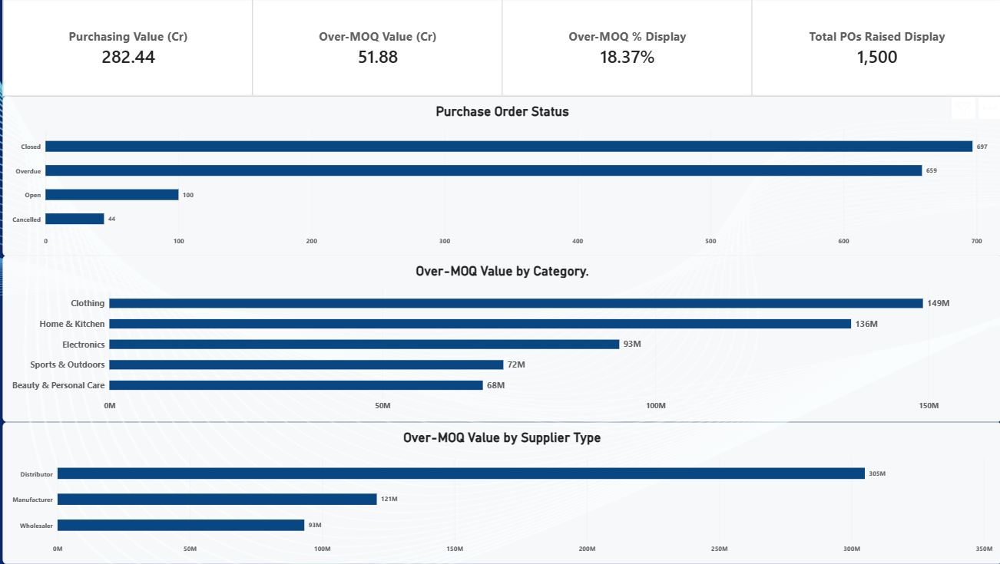
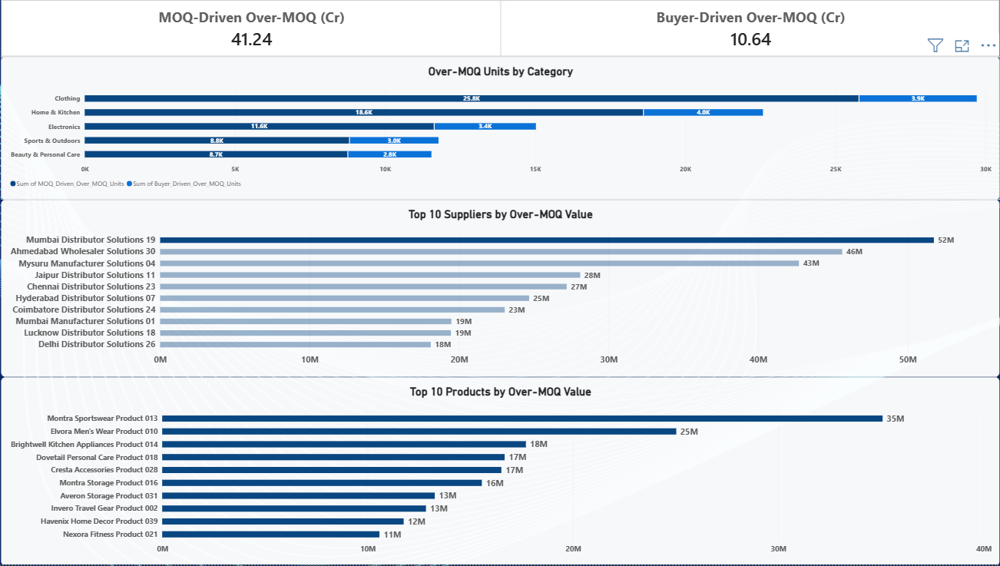
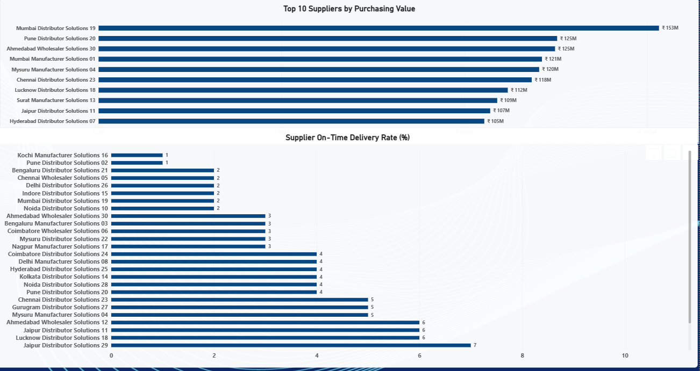
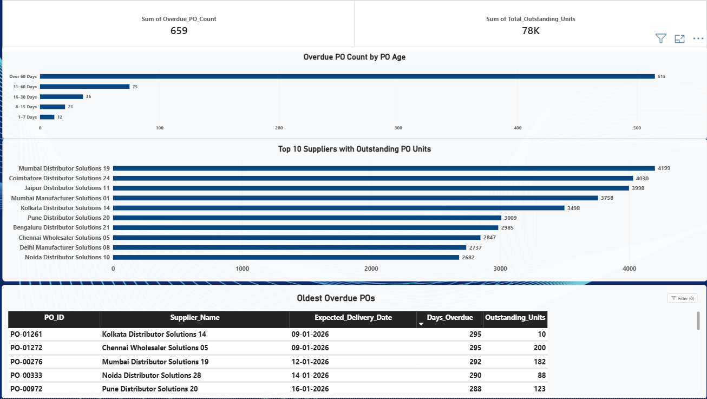

# ProcureWise – Procurement, Supplier & MOQ Analytics

## 1. Project Overview

ProcureWise is a procurement analytics project built around a fictional Indian retail business. The project examines purchasing patterns, supplier performance, Minimum Order Quantity (MOQ) requirements and purchase order backlogs.

The main objective is to understand how supplier MOQ requirements and additional purchasing decisions can result in orders exceeding the business's actual requirements, and to identify opportunities to improve purchasing decisions.

**Reporting period:** 1 January 2026 – 31 October 2026  
**Reporting currency:** Indian Rupees (INR)  
**Dataset:** Synthetic data created for this portfolio project.

## 2. Business Problem

Retail businesses often need to order quantities that are higher than their immediate requirements because suppliers impose minimum order quantities.

This can lead to additional purchasing beyond what the business originally needs. Buyers may also order quantities above the supplier's MOQ for their own planning reasons.

The project separates these two situations:

- **MOQ-driven Over-MOQ:** Additional quantity ordered because the supplier's MOQ was higher than the business requirement.
- **Buyer-driven Over-MOQ:** Additional quantity ordered above both the business requirement and the supplier's MOQ.

Understanding the difference helps businesses identify whether additional purchasing is driven by supplier conditions or internal purchasing decisions.

## 3. Project Objectives

- Measure the value and quantity of Over-MOQ purchases.
- Identify product categories and suppliers contributing most to Over-MOQ.
- Compare preferred suppliers with alternative suppliers.
- Review supplier delivery and quality performance.
- Identify overdue purchase orders and outstanding quantities.
- Highlight areas where procurement processes could be improved.

## 4. Tools Used

- **Python:** Synthetic data generation, data preparation and analysis.
- **SQL:** Data exploration, calculations and analysis using DuckDB.
- **DuckDB:** Database storage and querying.
- **Excel:** Detailed analysis tables and supporting calculations.
- **Power BI:** Interactive management dashboard.

## 5. Dataset Overview

The project uses six synthetic datasets covering:

- 300 products across five product categories.
- 30 suppliers.
- Supplier-product mappings.
- 1,500 purchase orders.
- 3,000 purchase order lines.
- 4,953 purchase receipt records.

The datasets were designed to represent a realistic procurement environment, including different supplier types, MOQ requirements, purchasing prices, delivery dates, receipts and quality rejections.

## 6. Key Findings

### Over-MOQ purchasing

- Total non-cancelled purchasing value: **₹282.44 crore**.
- Total Over-MOQ purchase value: **₹51.88 crore**.
- Over-MOQ represented **18.37%** of non-cancelled purchasing value.
- MOQ-driven Over-MOQ: **₹41.24 crore**.
- Buyer-driven Over-MOQ: **₹10.64 crore**.

### Category analysis

Clothing and Home & Kitchen together accounted for approximately 50.4% of the total Over-MOQ value.

### Supplier opportunities

The analysis identified 33 potential alternative-supplier opportunities based on pricing, MOQ, lead time and supplier delivery or quality performance.

These opportunities showed an average potential price difference of 15.74% compared with preferred suppliers, subject to the conditions used in the analysis.

### Supplier delivery performance

Among 1,394 completed purchase order lines:

- 130 lines (9.33%) were received on time.
- 1,264 lines (90.67%) were received late.

### Purchase order backlog

- 659 purchase orders were overdue as of the reporting cutoff.
- Outstanding quantity associated with these orders was 78,190 units.
- 515 overdue purchase orders had been overdue for more than 60 days.

## 7. Power BI Dashboard

The Power BI dashboard contains four pages covering procurement performance, Over-MOQ purchasing, supplier performance and purchase order exceptions.

### 1. Procurement Overview

Provides a summary of purchasing value, Over-MOQ impact, purchase order status and category-level analysis.

### 2. Over-MOQ Impact

Highlights MOQ-driven and buyer-driven Over-MOQ, with category, supplier and product-level comparisons.

### 3. Supplier Performance

Compares supplier purchasing value and on-time delivery performance.

### 4. PO Exceptions

Highlights overdue purchase orders, outstanding quantities and overdue ageing.

## 8. Project Deliverables

| Deliverable | File |
|---|---|
| Data generation and analysis notebook | `notebooks/01_Master_Data_Generation_Portfolio.ipynb` |
| Detailed analysis workbook | `data/final/ProcureWise_Procurement_Analysis.xlsx` |
| Power BI dashboard | `power_bi/ProcureWise_Procurement_Analytics.pbix` |
| Analytics report | `reports/ProcureWise_Procurement_Analytics_Report.docx` |

The Excel workbook provides detailed analysis tables, while the Power BI dashboard presents the key findings visually. The Word report explains the business problem, findings, recommendations and limitations.

## 9. Recommendations

Based on the analysis, the following areas deserve attention:

- Review MOQ requirements with suppliers, particularly in categories contributing most to Over-MOQ purchasing.
- Evaluate alternative suppliers where better pricing and purchasing conditions are available.
- Review supplier delivery performance and investigate recurring delays.
- Prioritise overdue purchase orders, especially those outstanding for more than 60 days.
- Track MOQ-driven and buyer-driven Over-MOQ separately to improve purchasing decisions.

## 10. Assumptions and Limitations

- All datasets are synthetic and created for demonstration purposes. They do not represent actual business transactions.
- The analysis covers procurement records up to 31 October 2026.
- Potential supplier savings are estimates based on the comparison criteria. They are not realised or guaranteed savings.
- Supplier delivery and quality performance are based on supplier-level records and may not reflect product-specific performance.
- Outstanding quantities are calculated using ordered quantities less accepted quantities. They should not automatically be interpreted as physically pending quantities, since rejected quantities may not yet have been replaced.
- Purchase order expected dates were generated independently of supplier-product lead-time mappings. Lead-time comparisons are therefore descriptive.
- The project does not include inventory data, so it does not estimate current unsold stock or actual working capital tied up in inventory.
- The project demonstrates an analytical workflow. Automated data refresh and ongoing procurement monitoring are not implemented.

## Conclusion

This project demonstrates how procurement data can be used to understand Over-MOQ purchasing, compare supplier options, review delivery performance and identify purchase order exceptions.

The analysis provides a starting point for more informed purchasing decisions and better supplier management. In a live business environment, the approach could be extended using actual procurement, inventory and supplier data.
